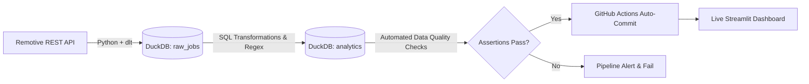

# Job-Market-Trends-Pipeline

# 📊 Data Analytics Job Market Pulse


[](https://github.com)
[](https://job-market-trends-pipeline-rdaekgkatbjvvnkjg83onn.streamlit.app/)

An end-to-end, automated ELT data pipeline and interactive analytics dashboard that tracks hiring velocity, seniority demand, and top technical skills across remote data roles.

🔗 **[Explore the Live Dashboard](https://job-market-trends-pipeline-rdaekgkatbjvvnkjg83onn.streamlit.app/)**


---

## 🏗️ Pipeline Architecture



## 🎯 Business Questions Answered

1. **Skill Demand Velocity:** Which technical skills (`SQL`, `Python`, `Power BI`, `Tableau`, `dbt`, `Snowflake`, `Excel`) appear most frequently in active job descriptions?
2. **Entry-Level Accessibility:** What share of active data roles target `Entry / Junior` candidates versus `Mid-Level` and `Senior` roles?
3. **Hiring Momentum:** How does daily job posting volume fluctuate over time across experience tiers?

## 🛠️ Tech Stack

* **Ingestion (`dlt`):** Automated REST API extraction, JSON flattening, and incremental upsert (`merge`) loading by primary key.
* **Storage & Transformation (`DuckDB` + `SQL`):** Dimensional modelling (`dim_jobs`, `fact_skill_demand`), regex-based skill extraction, and seniority classification.
* **Data Quality (`Python Assertions`):** Automated post-load validation checks verifying non-empty tables, zero null primary keys, and valid skill matches before committing data.
* **Orchestration (`GitHub Actions`):** Scheduled daily cron runs (`06:00 UTC`) with automated database commits and status badge reporting.
* **Visualization (`Streamlit` + `Plotly`):** Interactive dashboard with dynamic seniority filtering, KPI cards, and direct application links.

## 📂 Project Structure

```text
job-market-pulse/
├── .github/workflows/
│   └── daily_pipeline.yml      # Scheduled CI/CD workflow
├── pipeline/
│   ├── extract_load.py         # dlt ingestion & data quality checks
│   └── transform.sql           # DuckDB analytical transformations
├── app/
│   └── dashboard.py            # Streamlit BI application
├── data/
│   └── jobs.duckdb             # Embedded analytical database
├── requirements.txt
└── README.md
```

## 🚀 Run Locally

```bash
# 1. Clone the repository
git clone https://github.com
cd job-market-pulse

# 2. Install dependencies
pip install -r requirements.txt

# 3. Run the ELT pipeline and quality checks
python pipeline/extract_load.py

# 4. Launch the dashboard
streamlit run app/dashboard.py
```

